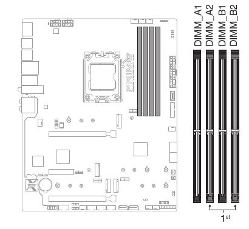

# ASUS PRIME X670E-PRO WIFI: AI Tweaker Voltage Guide

A reference for the voltage settings and readings on the **Ai Tweaker** page and its **Advanced Memory Voltages** sub-menu (AM5, Ryzen 7000/9000 series, DDR5).

> **How to read this guide**
>
> - **Setting** = something you can change (dropdown or text field).
> - **Reading** = a live, read-only measurement.
> - "Default" means what Auto or JEDEC typically uses. Exact Auto values vary by CPU, BIOS version, and memory kit.
> - "Typical safe range" is a general guideline for daily use on air or AIO cooling, not a guarantee. Check your specific CPU and RAM kit specs before changing anything.

---

## Your Current Values (from the screenshots)

| Item                       | Value                             | Mode          |
| -------------------------- | --------------------------------- | ------------- |
| Actual VRM Core Voltage    | 1.216 V                           | Auto          |
| Core Local Voltage Reading | 1.210 V                           | Reading       |
| CPU SOC Voltage            | 1.264 V                           | Auto          |
| SOC Local Voltage Reading  | 1.242 V                           | Reading       |
| CPU VDDIO / MC Voltage     | 1.392 V (set 1.380)               | Manual        |
| Misc Voltage               | 1.120 V                           | Auto          |
| VDDP Voltage               | Auto                              | Auto          |
| High DRAM Voltage Mode     | Auto                              | Auto          |
| DRAM VDD / VDDQ            | 1.380 V / 1.380 V                 | Manual (EXPO) |
| VDDG CCD Voltage           | 1060 mV                           | Dropdown      |
| VDDG IOD Voltage           | 960 mV                            | Dropdown      |
| Memory VPP Voltage         | 1.800 V                           | Manual        |
| CPU / Memory               | 4700 MHz, 43 °C, DDR5-6000, 32 GB | Reading       |

All of these sit within normal ranges for an EXPO 6000 MT/s configuration.

---

## Part 1: CPU Voltages (Ai Tweaker page)

### Actual VRM Core Voltage (setting + reading)

- **What it is:** The voltage the motherboard's VRM delivers to the CPU cores. The box on the left shows the live output; the dropdown sets the mode.
- **Modes:** Auto, Manual (fixed), Offset (adds or subtracts from what the CPU requests).
- **Default:** Auto. The value moves constantly with load (roughly 0.3 V at idle up to about 1.3 V under heavy load).
- **Typical range under load:** about 0.9 to 1.35 V.
- **Notes:** Manual mode locks the voltage and is usually worse for efficiency on Ryzen. Offset (negative) is the common way to undervolt.

### Core VID (setting)

- **What it is:** The voltage the CPU _requests_ from the VRM at its current frequency and load.
- **Default:** Auto.
- **Typical range:** about 0.4 to 1.5 V. Single-core boosts can briefly request high values.
- **Notes:** It is a request, not a measurement. The real voltage differs because of load-line droop.

### Core Local Voltage Reading (reading)

- **What it is:** The true core voltage as sensed by the processor itself.
- **Notes:** The most accurate core voltage number on the page. It is normally a few millivolts below the VRM output.

### CPU SOC Voltage (setting)

- **What it is:** Powers the System on Chip: memory controller, Infinity Fabric, PCIe, USB, and integrated graphics.
- **Default:** Auto. About 1.0 to 1.05 V at JEDEC memory speeds; EXPO at DDR5-6000 commonly raises it to about 1.2 to 1.3 V.
- **Typical safe range:** 1.0 to 1.3 V.
- **Hard limit:** AMD and ASUS cap SOC at **1.3 V** in current BIOS versions. Higher SOC voltage on early AM5 BIOS releases damaged CPUs.
- **Notes:** Higher memory speeds and tight timings may need more SOC. Your 1.264 V is on the higher side of normal, but within the limit.

### SOC Local Voltage Reading (reading)

- **What it is:** The measured SOC voltage. It is normally slightly below the set or requested value.

### CPU VDDIO / MC Voltage (setting + reading)

- **What it is:** Voltage for the memory controller's I/O interface (also called VDDIO_MEM). It handles signaling between the CPU and the RAM.
- **Default:** About 1.1 V at JEDEC speeds. With EXPO, it usually follows DRAM VDDQ (for example 1.35 to 1.40 V).
- **Typical safe range:** 1.1 to 1.4 V.
- **Notes:** Keep it equal to or slightly above DRAM VDDQ. Your 1.38 V manual value matches your RAM voltage. The reading (1.392 V) is a few millivolts above the setting, which is normal.

---

## Part 2: Memory Voltages (Ai Tweaker page)

### Misc Voltage (setting + reading)

- **What it is:** An auxiliary rail (VDD_MISC) feeding miscellaneous on-die blocks, including parts related to memory clocks and Infinity Fabric.
- **Default:** Auto, about 1.1 V.
- **Typical range:** about 1.0 to 1.2 V.
- **Notes:** Rarely needs adjustment. Leave on Auto unless you are doing advanced memory tuning.

### VDDP Voltage (setting)

- **What it is:** A CPU-internal rail that supports the memory PHY and fabric logic.
- **Default:** Auto, about 0.8 V.
- **Typical range:** about 0.8 to 1.0 V.
- **Notes:** An advanced memory-stability setting. Leave on Auto.

### High DRAM Voltage Mode (setting)

- **What it is:** Unlocks the higher DRAM voltage range on the board.
- **Options:** Auto, Enabled, Disabled.
- **Default:** Auto.
- **Notes:** Only relevant if you plan to run DRAM voltage above the standard range. Leave on Auto otherwise.

### DRAM VDD Voltage (setting)

- **What it is:** The main supply voltage for the DRAM chips themselves (cells, core logic).
- **Default:** 1.10 V (JEDEC DDR5 standard). EXPO and XMP kits usually set 1.25 to 1.40 V depending on speed.
- **Typical safe range:** 1.1 to 1.4 V for daily use. Some enthusiasts go up to about 1.45 V with active cooling.
- **Notes:** Your 1.38 V is consistent with a DDR5-6000 EXPO profile. DDR5 has on-module voltage regulation (PMIC), so heat on the DIMMs matters. Consider airflow over the RAM if you raise it.

### DRAM VDDQ Voltage (setting)

- **What it is:** The voltage for the DRAM's I/O (data lines).
- **Default:** 1.10 V JEDEC; EXPO typically sets it equal to VDD.
- **Typical safe range:** 1.1 to 1.4 V.
- **Notes:** Usually kept equal to VDD. It is a tuning variable for high speeds.

### VDDG CCD Voltage (setting)

- **What it is:** Voltage for the Infinity Fabric link between each CPU chiplet (CCD) and the I/O die.
- **Default:** Auto, typically around 0.9 to 1.0 V. Some boards and BIOS versions apply about 1.06 V when memory is overclocked.
- **Typical range:** about 0.85 to 1.1 V.
- **Notes:** Mostly helps with fabric stability at high FCLK or memory speeds. Leave as is unless troubleshooting.

### VDDG IOD Voltage (setting)

- **What it is:** Voltage for the I/O die side of the same Infinity Fabric link.
- **Default:** Auto, typically around 0.9 to 1.0 V.
- **Typical range:** about 0.85 to 1.1 V.
- **Notes:** Works together with VDDG CCD. Your 960 mV is in the normal range.

---

## Part 3: Advanced Memory Voltages (sub-menu)

### PMIC Force Continuous Current Mode (setting)

- **What it is:** Forces the DIMM's power management IC to stay in continuous conduction mode instead of switching modes at light loads.
- **Options:** Auto, Enabled, Disabled.
- **Default:** Auto.
- **Notes:** Can improve stability or voltage ripple at high speeds, at a small efficiency cost. Leave on Auto.

### PMIC Voltages (setting)

- **What it is:** Controls whether all DIMM PMICs share the same voltage settings.
- **Options:** Auto, Sync All PMICs, Unsync All PMICs.
- **Default:** Sync All PMICs (or Auto, which behaves the same).
- **Notes:** Unsync lets you set each module separately. Only useful in advanced tuning.

### SPD HUB VLDO (1.8 V) (setting)

- **What it is:** The supply voltage for the SPD hub, the small chip on each DIMM that stores the module's configuration and handles sensors.
- **Default:** 1.8 V (Auto).
- **Typical range:** about 1.7 to 1.9 V.
- **Notes:** Leave on Auto.

### SPD HUB VDDIO (1.0 V) (setting)

- **What it is:** The I/O voltage for the SPD hub.
- **Default:** 1.0 V (Auto).
- **Typical range:** about 0.9 to 1.1 V.
- **Notes:** Leave on Auto.

### Memory VDD Voltage / Memory VDDQ Voltage (setting)

- **What they are:** The same VDD and VDDQ values as on the main page, exposed here for the PMICs. Changing one updates the other.
- **Default and range:** See DRAM VDD and DRAM VDDQ above.

### Memory VPP Voltage (setting)

- **What it is:** The wordline pump voltage. It drives the row activation circuitry inside the DRAM.
- **Default:** 1.80 V.
- **Typical range:** 1.8 to 2.0 V. Many daily setups stay at 1.8 V.
- **Notes:** Slightly increasing VPP can help stability at very tight timings, but most users never need to.

### Memory Voltage Switching Frequency (setting)

- **What it is:** How fast the DIMM's PMIC switches its internal regulator.
- **Default:** Auto.
- **Notes:** Higher frequency gives smoother voltage but generates more heat. Leave on Auto.

### Memory Current Capability (setting)

- **What it is:** Sets the current limit the DIMM's PMIC can deliver.
- **Default:** Auto (typically 100%).
- **Typical options:** 100% to about 140% in steps.
- **Notes:** Raising it can help stability at high memory voltage or speed, but it is another source of extra heat.

---

## Quick Reference Table

| Voltage          | Default / Auto                             | Typical Safe Range       | Hard Limit / Caution                     |
| ---------------- | ------------------------------------------ | ------------------------ | ---------------------------------------- |
| VRM Core Voltage | Dynamic (0.3 to 1.3 V)                     | 0.9 to 1.35 V under load | Avoid sustained values above about 1.4 V |
| Core VID         | Dynamic                                    | 0.4 to 1.5 V             | Request only                             |
| CPU SOC          | 1.0 to 1.05 V (JEDEC), 1.2 to 1.3 V (EXPO) | 1.0 to 1.3 V             | **1.3 V max**                            |
| CPU VDDIO / MC   | 1.1 V (JEDEC), about 1.35 V (EXPO)         | 1.1 to 1.4 V             | Keep near VDDQ                           |
| Misc Voltage     | about 1.1 V                                | 1.0 to 1.2 V             | Leave on Auto                            |
| VDDP             | about 0.8 V                                | 0.8 to 1.0 V             | Leave on Auto                            |
| VDDG CCD         | about 0.9 to 1.0 V                         | 0.85 to 1.1 V            | Leave on Auto                            |
| VDDG IOD         | about 0.9 to 1.0 V                         | 0.85 to 1.1 V            | Leave on Auto                            |
| DRAM VDD         | 1.10 V JEDEC, 1.25 to 1.40 V EXPO          | 1.1 to 1.4 V             | About 1.45 V with active cooling         |
| DRAM VDDQ        | 1.10 V JEDEC, same as VDD for EXPO         | 1.1 to 1.4 V             | Keep equal to VDD                        |
| SPD HUB VLDO     | 1.8 V                                      | 1.7 to 1.9 V             | Leave on Auto                            |
| SPD HUB VDDIO    | 1.0 V                                      | 0.9 to 1.1 V             | Leave on Auto                            |
| Memory VPP       | 1.8 V                                      | 1.8 to 2.0 V             | Leave at 1.8 V unless needed             |

---

## General Tips

1. **Change one thing at a time** and test for stability (for example with OCCT or TestMem5) before changing the next setting.
2. **Heat matters.** Check CPU temperatures and DIMM temperatures after raising memory voltage or current.
3. **Auto is a good default.** The motherboard and CPU already tune most of these rails well for stock use.
4. **Use the manual's maximums as a ceiling, not a target.** Safe daily limits are lower than what the BIOS will let you enter.
5. **Reset if unstable.** Use _Load Optimized Defaults_ in the Exit tab, or the Clear CMOS button on the back I/O panel.

> **Disclaimer:** The ranges above are general guidance for AM5 platforms and can differ between CPU models, BIOS versions, and memory kits. Always check your hardware's official specifications before changing voltages.

# Memory slots

| Board label | dmidecode name    | I2C address | Status |
| ----------- | ----------------- | ----------- | ------ |
| DIMM_A1     | Channel A, DIMM 0 | 0x50        | Empty  |
| **DIMM_A2** | Channel A, DIMM 1 | **0x51**    | 16 GiB |
| DIMM_B1     | Channel B, DIMM 0 | 0x52        | Empty  |
| **DIMM_B2** | Channel B, DIMM 1 | **0x53**    | 16 GiB |



```shell
sudo dmidecode -t memory | grep -E "Locator|Size"
       Size: No Module Installed
       Locator: DIMM 0
       Bank Locator: P0 CHANNEL A
       ---
       Size: 16 GiB
       Locator: DIMM 1
       Bank Locator: P0 CHANNEL A
       Non-Volatile Size: None
       Volatile Size: 16 GiB
       Cache Size: None
       Logical Size: None
       ---
       Size: No Module Installed
       Locator: DIMM 0
       Bank Locator: P0 CHANNEL B
       ---
       Size: 16 GiB
       Locator: DIMM 1
       Bank Locator: P0 CHANNEL B
       Non-Volatile Size: None
       Volatile Size: 16 GiB
       Cache Size: None
       Logical Size: None
```
